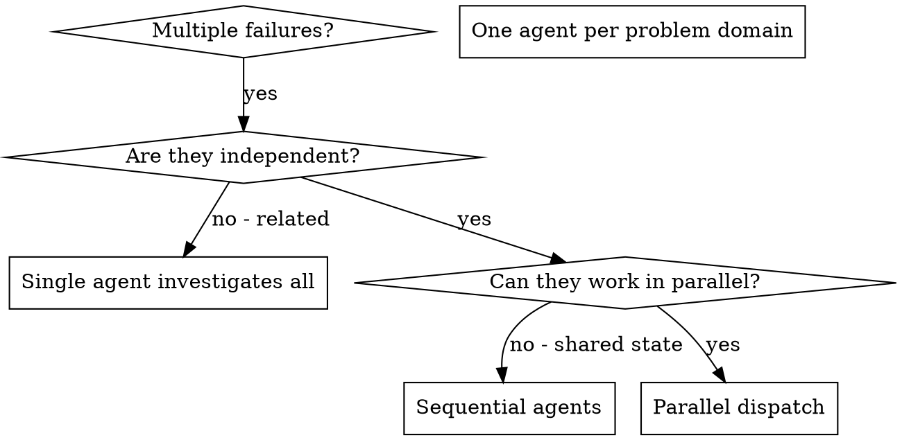

# Параллельный запуск агентов

## Обзор

Ты делегируешь задачи специализированным агентам с изолированным контекстом. Точно формулируя их инструкции и контекст, ты удерживаешь их в рамках задачи и помогаешь им её решить. Им никогда не нужно наследовать контекст и историю твоей сессии — ты передаёшь ровно то, что им нужно. Так сохраняется твой собственный контекст для координации работы.

Когда есть несколько несвязанных сбоев (разные тестовые файлы, разные подсистемы, разные баги), их последовательное разбирание занимает много времени. Каждое расследование независимо и может идти параллельно.

**Ключевой принцип:** запускай по одному агенту на каждую независимую область проблемы. Пусть они работают одновременно.

## Когда использовать



**Используй, когда:**
- 3+ тестовых файлов падают с разными первопричинами
- Несколько подсистем сломаны независимо друг от друга
- Каждую проблему можно понять без контекста остальных
- Между расследованиями нет общего состояния

**Не используй, когда:**
- Сбои связаны (исправление одного может исправить и другие)
- Нужно понимать состояние всей системы целиком
- Агенты будут мешать друг другу

## Порядок действий

### 1. Определи независимые области

Сгруппируй сбои по тому, что сломано:
- Тесты файла A: поток подтверждения инструментов
- Тесты файла B: поведение при завершении пакетной обработки
- Тесты файла C: функциональность прерывания

Каждая область независима — исправление подтверждения инструментов не влияет на тесты прерывания.

### 2. Создай сфокусированные задачи для агентов

Каждый агент получает:
- **Конкретную область:** один тестовый файл или одну подсистему
- **Чёткую цель:** сделать эти тесты зелёными
- **Ограничения:** не менять другой код
- **Ожидаемый результат:** сводку того, что он нашёл и исправил

### 3. Запускай параллельно

Отправь все три вызова субагентов в одном ответе — они выполнятся параллельно:

```text
Subagent (general-purpose): "Fix agent-tool-abort.test.ts failures"
Subagent (general-purpose): "Fix batch-completion-behavior.test.ts failures"
Subagent (general-purpose): "Fix tool-approval-race-conditions.test.ts failures"
# All three run concurrently.
```

Несколько вызовов в одном ответе = параллельное выполнение. По одному вызову в ответе = последовательное.

### 4. Проверь результаты и объедини

Когда агенты вернут результаты:
- Прочитай каждую сводку
- Проверь, что исправления не конфликтуют
- Запусти полный набор тестов
- Объедини все изменения

## Структура промпта для агента

Хорошие промпты для агентов:
1. **Сфокусированные** — одна чёткая область проблемы
2. **Самодостаточные** — содержат весь контекст, нужный для понимания проблемы
3. **Конкретные в описании результата** — что агент должен вернуть?

```markdown
Fix the 3 failing tests in src/agents/agent-tool-abort.test.ts:

1. "should abort tool with partial output capture" - expects 'interrupted at' in message
2. "should handle mixed completed and aborted tools" - fast tool aborted instead of completed
3. "should properly track pendingToolCount" - expects 3 results but gets 0

These are timing/race condition issues. Your task:

1. Read the test file and understand what each test verifies
2. Identify root cause - timing issues or actual bugs?
3. Fix by:
   - Replacing arbitrary timeouts with event-based waiting
   - Fixing bugs in abort implementation if found
   - Adjusting test expectations if testing changed behavior

Do NOT just increase timeouts - find the real issue.

Return: Summary of what you found and what you fixed.
```

## Частые ошибки

**❌ Слишком широко:** «Исправь все тесты» — агент теряется
**✅ Конкретно:** «Исправь agent-tool-abort.test.ts» — сфокусированная область

**❌ Нет контекста:** «Исправь race condition» — агент не знает, где искать
**✅ Контекст:** вставь текст ошибок и названия тестов

**❌ Нет ограничений:** агент может переписать всё подряд
**✅ Ограничения:** «НЕ меняй продакшен-код» или «Исправляй только тесты»

**❌ Расплывчатый результат:** «Исправь это» — непонятно, что изменилось
**✅ Конкретно:** «Верни сводку первопричины и внесённых изменений»

## Когда НЕ использовать

**Связанные сбои:** исправление одного может исправить другие — сначала исследуй их вместе
**Нужен полный контекст:** для понимания требуется видеть всю систему
**Исследовательская отладка:** ты ещё не знаешь, что сломано
**Общее состояние:** агенты будут мешать друг другу (правят одни и те же файлы, используют одни и те же ресурсы)

## Реальный пример из сессии

**Ситуация:** 6 падающих тестов в 3 файлах после крупного рефакторинга

**Сбои:**
- agent-tool-abort.test.ts: 3 сбоя (проблемы с таймингом)
- batch-completion-behavior.test.ts: 2 сбоя (инструменты не выполняются)
- tool-approval-race-conditions.test.ts: 1 сбой (счётчик выполнений = 0)

**Решение:** области независимы — логика прерывания отдельно от завершения пакетов и отдельно от race conditions

**Запуск:**
```
Agent 1 → Fix agent-tool-abort.test.ts
Agent 2 → Fix batch-completion-behavior.test.ts
Agent 3 → Fix tool-approval-race-conditions.test.ts
```

**Результаты:**
- Агент 1: заменил таймауты ожиданием по событиям
- Агент 2: исправил ошибку структуры события (threadId был не на своём месте)
- Агент 3: добавил ожидание завершения асинхронного выполнения инструмента

**Интеграция:** все исправления независимы, конфликтов нет, полный набор тестов зелёный

## Проверка

После того как агенты вернут результаты:
1. **Прочитай каждую сводку** — пойми, что изменилось
2. **Проверь конфликты** — не правили ли агенты один и тот же код?
3. **Запусти полный набор тестов** — убедись, что все исправления работают вместе
4. **Выборочно проверь** — агенты могут допускать системные ошибки
