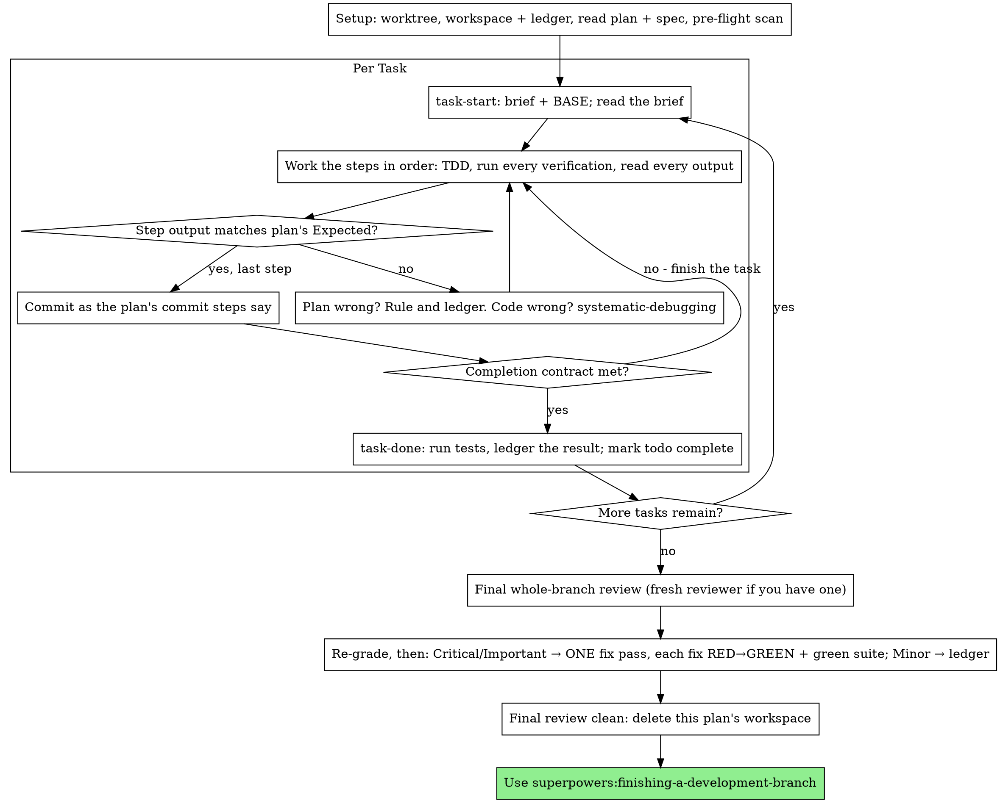

# Выполнение планов

Выполняй план сам, задачу за задачей, в этой сессии: без отдельного субагента-исполнителя на каждую задачу и без ревьюера на каждую задачу. В конце — одно код-ревью всей ветки в свежем контексте.

**Почему inline:** Разработка на субагентах оплачивает свежего исполнителя и свежего ревьюера на каждую задачу, и каждый заново читает кодовую базу с нуля. Выполнение inline оплачивает один контекст (твой) плюс одного ревьюера в конце. Отказываешься ты от свежего контекста на каждую задачу и от второй пары глаз на каждую задачу. Этот скил сохраняет то, что давали эти две вещи, другими средствами: бриф — это спецификация, журнал (ledger) — твоя память, TDD — проверка на каждой задаче, а финальный ревьюер — вторая пара глаз.

**Основной принцип:** Основную работу мысли план уже сделал. Выполняй его точно, подтверждай каждый шаг тестом, который ты видел сначала упавшим, а потом прошедшим, и оставляй запись, которая переживёт твою собственную забывчивость.

**Комментарии:** между вызовами инструментов пиши не больше одной короткой строки — запись ведут журнал и результаты инструментов.

**Непрерывное выполнение:** Не останавливайся, чтобы свериться с человеком-партнёром между задачами. Он выбрал выполнение inline, чтобы тратить меньше, а не чтобы после каждой задачи отвечать на вопрос «продолжать?». Выполняй все задачи плана без остановок.

**Решения, а не остановки.** Конфликты, неоднозначности, дефекты плана — решай их сам. Спецификация — обязательный авторитет, план — её аргументация, а то, на что не отвечает ни то ни другое, решает твоё суждение. Записывай каждое решение в журнал как `Ruling: <что решил> — <почему> — <чем это обернётся, если ошибся>` и продолжай. Отступление от плана без записи Ruling в журнале — это решение, принятое тайком.

Останавливают тебя четыре вещи, и только они: необратимая или разрушительная операция; действие, связанное с безопасностью; побочный эффект за пределами этого worktree, о котором принято спрашивать заранее (слияние, push в общую ветку, публикация); и план настолько сломанный, что любой путь вперёд — догадка. В этих случаях остановись и спроси.

## Когда использовать

- У тебя есть план от superpowers:writing-plans, и твой человек-партнёр выбрал выполнение inline при передаче.
- В твоей среде нет инструмента субагента (см. описания по платформам в `../using-superpowers/references/`). Никогда не выдумывай вызов субагента; выполняй план здесь.
- Задачи в основном независимы — то же условие, что и для superpowers:subagent-driven-development.

Полностью проработанный план превращает выполнение inline в переписывание плюс тестирование: оно хорошо идёт на модели среднего уровня, а единственное место, где самая мощная модель оправдывает свою стоимость, — финальное ревью, которое этот скил запускает отдельно. Скажи об этом своему человеку-партнёру, когда он выберет inline.

Предпочитай superpowers:subagent-driven-development, когда твой человек-партнёр хочет контрольную проверку на каждой задаче или когда план настолько длинный, что его поздние задачи выполнялись бы на сжатом контексте. Выполнение inline по длинному плану всё равно работает — журнал делает его восстановимым, — но последним задачам достаётся меньше всего тебя.

## Процесс

## Подготовка

Убедись, что работа ведётся в изолированном рабочем пространстве: используй superpowers:using-git-worktrees, чтобы создать его или проверить существующее. Никогда не начинай реализацию в ветке main/master без явного согласия твоего человека-партнёра.

Память разговора не переживает сжатия контекста. Исполнитель inline, потерявший своё место, заново реализует задачи, коммиты которых уже существуют, — тот же сбой, что и у контроллера, повторно отправляющего задачи, только оплаченный твоим собственным контекстом. Отслеживай прогресс в файле-журнале, а не только в todo. Todo среды — это живое представление; журнал — это запись.

Рабочее пространство и журнал общие с superpowers:subagent-driven-development — тот же каталог, тот же формат, — так что план может сменить исполнителя на ходу, и новый продолжит с того же журнала.

- У каждого плана своё рабочее пространство: в начале скила выполни `../subagent-driven-development/scripts/sdd-workspace PLAN_FILE` — он выведет игнорируемый git каталог плана (`<repo-root>/.superpowers/sdd/<plan-basename>/`), где лежат все артефакты ЭТОГО плана: журнал, брифы, пакеты для ревью. Каталог другого плана тебе читать и менять нельзя.
- Проверь, есть ли журнал этого плана в `<workspace>/progress.md`. Если его первая строка называет твой файл плана, задачи со строкой `Task <N>: complete` ВЫПОЛНЕНЫ — не переделывай их; продолжай с первой задачи без такой строки. Их коммиты существуют в git, даже когда твой контекст уже не помнит, как ты их делал: после сжатия контекста доверяй журналу и `git log`, а не собственным воспоминаниям. Журнал, чья первая строка называет другой файл плана, — это прогресс другого плана: оставь его и начни свой, с чистого листа.
- Создай журнал, поместив его идентификатор в первую строку: `# SDD ledger — plan: <plan file path>`.
- `git clean -fdx` уничтожит рабочее пространство (это игнорируемый git черновой каталог); если это случилось, восстанавливайся по `git log`.

Прочитай план один раз, отметь его контекст и Global Constraints и создай todo на каждую задачу. Если в плане назван Spec, прочитай и его: спецификация — это авторитет, из которого исходит план, и конфликты внутри плана разрешаются в её пользу. Если у плана нет доступной спецификации, добавь в журнал заметку об этом: решения, принятые без неё, предварительные.

**ОБЯЗАТЕЛЬНЫЙ СУБ-СКИЛ:** загрузи superpowers:test-driven-development прямо сейчас, до Задачи 1. Он управляет каждым шагом каждой задачи ниже; то, что шаги плана уже говорят «сначала напиши падающий тест», не освобождает тебя от его прочтения.

Перед Задачей 1 просмотри план на конфликты между задачами. Блоки Interfaces в плане подсказывают, где смотреть: на каждую задачу, которая потребляет то, что производит более ранняя задача, — одна строка в журнале: две задачи, что одна производит и что другая потребляет, и что ты обнаружил. Задачи, у которых нет ничего общего, строки не получают; план, где у задач нет ничего общего, получает единственную строку `Pre-flight: no shared interfaces`. Разреши каждый конфликт, который выявила строка, считая спецификацию обязательным авторитетом, запиши решение рядом со строкой и начинай Задачу 1. Собственный текст каждой задачи проверяется, когда ты читаешь её бриф, а не здесь.

## Цикл задачи

Всё, что ты выводишь, и каждый результат инструмента остаётся в твоём контексте до конца сессии. Перенаправляй длинный вывод тестов в файл в рабочем пространстве и читай его конец; читай бриф, а не весь план.

### 1. Возьми задачу

- Запусти `scripts/task-start PLAN_FILE N` этого скила. Он одним вызовом выводит путь к брифу и BASE (коммит, от которого отсчитывается диапазон задачи). Читай бриф для каждой задачи, в том числе тех, что помнишь по подготовке: то, что ты помнишь, — это краткое изложение, а в брифе точные значения, сигнатуры и тестовые случаи.
- Отметь todo задачи как in_progress.

Каждый вызов инструмента — это ход, который заново читает весь твой контекст. Учёт ходит вместе с работой — запись в журнал делается в том же вызове, что и коммит, а не в отдельном.

### 2. Выполни шаги

Шаги плана уже расположены в порядке RED-GREEN; следуй этому порядку, руководствуясь superpowers:test-driven-development, загруженным при подготовке. Код шага с тестом пишется первым и запускается первым. Наблюдать, как он падает, — это шаг, а не формальность: тест, который проходит до появления реализации, — это находка о самом тесте.

Каждый шаг, запускающий команду, имеет строку `Expected:`. Запусти команду, прочитай вывод и сравни. Три исхода:

- **Совпадает.** Следующий шаг.
- **Код неверен.** Используй superpowers:systematic-debugging. Найди причину; никогда не подгоняй симптом, чтобы вывод совпал с шагом.
- **План неверен** — шаг противоречит спецификации, интерфейс из более ранней задачи не совпадает с тем, что потребляет эта, или команда не может работать. Выбери наименьшее изменение, удовлетворяющее спецификации, запиши его в журнал как `Task <N>: Ruling: <находка> — <что решил и почему>` и продолжай. Решение переносится, а не запоминается: последующие задачи, затрагивающие тот же интерфейс, читают его из журнала.

Делай коммиты так, как говорят шаги коммита в плане. Задача из нескольких коммитов — нормально; BASE — это то, от чего отсчитывается диапазон ревью, а никогда не `HEAD~1`.

### 3. Контракт завершения

Перед строкой задачи в журнале всё следующее верно, с доказательствами в этой сессии — а не выведено из того, что дифф выглядит правильным:

- Каждый тест, названный в брифе, существует и был запущен в этой задаче, и ты прочитал вывод.
- Итоговый запуск тестов для задачи прошёл — `task-done` и есть этот запуск, и он записывает команду и результат в строку журнала.
- Каждая строка `Expected:` в брифе сверена с реальным выводом.
- У каждого отступления от брифа есть строка `Ruling:` в журнале.

**ОБЯЗАТЕЛЬНЫЙ СУБ-СКИЛ:** superpowers:verification-before-completion управляет утверждением о готовности. Если чего-то из списка не хватает, задача не завершена: доведи её.

### 4. Заверши задачу

Запусти `scripts/task-done PLAN_FILE N BASE -- <test command>` этого скила с тестовой командой, которую бриф называет для всей задачи. Он запускает тесты, сохраняет полный вывод в рабочем пространстве, печатает его конец и — только если тесты прошли — дописывает строку о завершении в журнал:

`Task <N>: complete (commits <base7>..<head7>, tests: <command> → <result>)`

Упавший запуск ничего не записывает; задача не завершена. Когда запись сделана, отметь todo выполненным и бери следующую задачу.

## Финальное ревью

Запусти `../subagent-driven-development/scripts/review-package PLAN_FILE MERGE_BASE HEAD` (MERGE_BASE — коммит, с которого началась ветка, например `git merge-base main HEAD`) и веди ревью по файлу, который он выведет.

**С инструментом субагента:** отправь ревьюера на самой мощной доступной модели — ревью всей ветки это задача на суждение — используя [code-reviewer.md](../requesting-code-review/code-reviewer.md) из superpowers:requesting-code-review, с путём к пакету, путями к плану и спецификации, разделом Review Focus плана дословно, если он есть (классы входных данных и виды сбоев, которые тесты плана не проверяют, — ревьюер проверяет каждый намеренно), и указанием на строки `Ruling:` в журнале, чтобы он мог оценить принятые тобой решения. Укажи модель явно; пропущенная модель наследуется от сессии, а она может быть не самой мощной. Это тот единственный свежий контекст, который покупает весь прогон. Не пропускай его и не заменяй собственным чтением диффа.

**Без инструмента субагента:** прочитай code-reviewer.md и проведи это ревью сам по пакету, отдельным проходом после строки журнала последней задачи. Запиши в журнал `Final review: self-review (no subagent tool)` и скажи об этом в своём финальном сообщении: самоперепроверка автором слабее свежего ревьюера, и твой человек-партнёр решает, достаточно ли этого перед слиянием.

Отсортируй находки, прежде чем действовать по какой-либо из них. Метки серьёзности от ревьюера — совет; решающее слово за тобой. Его список «Declined to judge» тоже твой: каждая строка там — решение, которое ты принимаешь и заносишь в журнал, точно так же, как конфликт плана — `Final: Ruling: <поведение, которое ревьюер отложил> — <что получает разумный человек, использующий это ПО, и почему это остаётся в силе или почему это теперь находка> — <цена, если ошибся>`. Сначала переоцени по последствиям: спецификация — это документ-видение, а оценка находки — это то, что получает разумный человек, использующий это ПО, если оно выйдет, а не то, названо ли во входных данных, которые её вызывают, в спецификации; ревьюер, поставивший находке Minor, потому что спецификация молчала, оценил спецификацию, а не последствия. Затем:

- **Critical и Important** попадают в проход исправлений.
- **Minor** идёт в журнал как `Final: minor (deferred): <одна строка>` и в твоё финальное сообщение под заголовком «Deferred minors». Minor никогда не попадают в проход исправлений и никогда не становятся решениями (rulings) — решение касается конфликта, а не заметки о том, что ты отклонил предложение по шлифовке.

Исправь находки Critical и Important сам — здесь ты исполнитель — за ОДИН проход. Каждое исправление проверяется через TDD, а не вторым ревьюером: напиши тест, воспроизводящий находку, посмотри, как он падает, сделай так, чтобы он прошёл, затем запусти весь набор тестов. Записывай каждое в журнал как `Final: fixed <находка> — <имя теста> RED→GREEN, suite <N>/<N>`. Исправление без теста, который сначала упал, не проверено; набор тестов, не зелёный после прохода, означает, что проход не закончен. Не запускай повторное ревью: оно перечитало бы дифф, на вопрос «исправлено ли» по которому уже отвечают покрывающие тесты, а на вопрос «ничего не сломано» — уже выполненный запуск набора.

Находка, которую ты решил не исправлять, — это решение: `Final: Ruling: <находка> — <почему код остаётся> — <цена, если ошибся>`, и она доходит до твоего человека-партнёра в списке решений. Второго прохода исправлений нет.

## Завершение

Прежде чем что-либо удалять, собери каждую строку журнала, содержащую `Ruling:`, в своё финальное сообщение под заголовком «Rulings I made», в порядке их принятия, каждую с ценой ошибки, и каждую строку `minor (deferred)` под заголовком «Deferred minors». Оба списка исчерпывающие. Твоё финальное сообщение — единственное место, где решения, принятые тобой от имени твоего человека-партнёра, и находки, по которым ты решил не действовать, доходят до него.

Когда финальное ревью чистое и его исправления закоммичены, удали каталог рабочего пространства этого плана — теперь записью служит история git. Соседние каталоги принадлежат другим планам; не трогай их.

Используй superpowers:finishing-a-development-branch.

## Типичные самооправдания

| Отговорка | Реальность |
|-----------|------------|
| «Я помню, что говорится в Задаче N» | Ты помнишь краткое изложение. В брифе точные значения. Прочитай его. |
| «Код плана верен, можно не смотреть, как тест падает» | Тест, который ты не видел упавшим, ничего не доказывает. Это один шаг. Запусти его. |
| «Я запущу весь набор в конце, а не на каждом шаге» | Запуски по шагам — способ узнать, какой шаг всё сломал. Запуск в конце задачи — это контракт, а не замена. |
| «План здесь неверен, я просто сделаю правильно» | Сделай правильно и запиши решение в журнал. Незаписанное отступление — решение, принятое тайком. |
| «Строки в журнал допишу после нескольких задач» | Сжатие контекста не ждёт удобного момента. Одна строка на задачу, в том же сообщении, что и коммит. |
| «Давай свериться перед следующей задачей» | Он выбрал inline, чтобы тратить меньше. Запросы о прогрессе тратят его время. Останавливают только четыре остановки. |
| «Я внимательно прочитал свой дифф; финальный ревьюер лишний» | Тот же автор, те же слепые пятна. Ревьюер — единственный свежий контекст, который покупает этот прогон. |
| «Тесты должны пройти, изменение было тривиальным» | «Должны» — это не доказательство. Контракт требует команду и её вывод. |
| «Субагенты медленные и дорогие, пропущу и финальное ревью» | Inline уже убрал ревьюеров по задачам. Одно ревью всей ветки — нижняя планка, а не потолок. |
| «Ревьюер сказал Minor, значит это Minor» | Метка оценила молчание спецификации. Оцени то, что получит человек. Переоцени, затем принимай решение. |
| «Исправление очевидно, падающий тест сначала не нужен» | Падающий тест — единственное доказательство, что находка была реальной и теперь исчезла. Без него у тебя дифф и надежда. |
| «Заодно исправлю и minor» | Каждый исправленный minor — это тест, исправление и запуск набора, о которых твой партнёр не просил. Запиши их в журнал; решает твой партнёр. |
