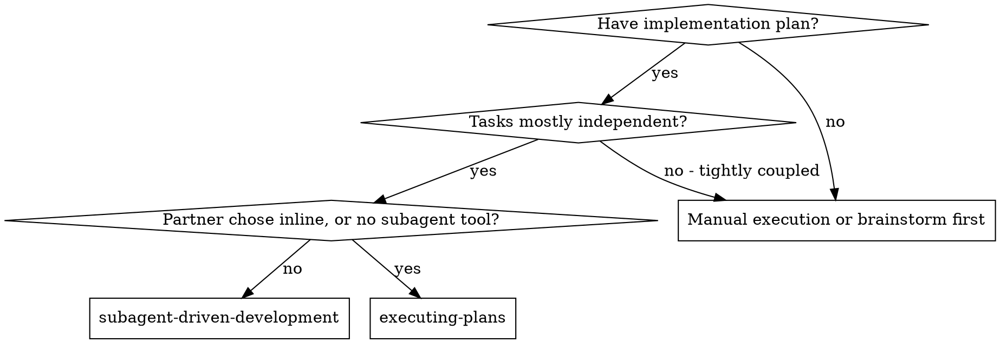
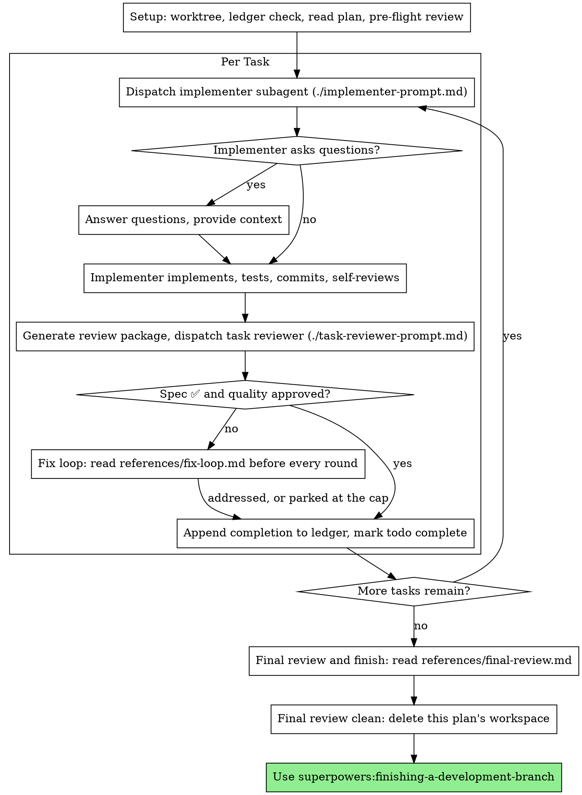

# Разработка через субагентов

Выполняй план, отправляя на каждую задачу свежего субагента-исполнителя, после каждой задачи — ревью задачи (соответствие спецификации + качество кода), а в конце — широкое ревью всей ветки.

**Зачем субагенты:** ты делегируешь задачи специализированным агентам с изолированным контекстом. Точно сформулировав их инструкции и контекст, ты обеспечиваешь, что они остаются сфокусированными и справляются с задачей. Они НИКОГДА не должны наследовать контекст или историю твоей сессии — ты собираешь ровно то, что им нужно. Это же сохраняет твой собственный контекст для координации.

**Главный принцип:** свежий субагент на задачу + ревью задачи (спецификация + качество) + широкое финальное ревью = высокое качество и быстрые итерации

**Комментарии:** между вызовами инструментов пиши не более одной короткой строки — журнал (ledger) и результаты инструментов хранят всю запись.

**Непрерывное выполнение:** не останавливайся, чтобы согласовать что-то с твоим партнёром-человеком между задачами. Выполняй все задачи плана без остановок. Остановиться можно только по четырём причинам, перечисленным ниже, или когда все задачи выполнены. Вопросы вроде «Продолжать?» и сводки о ходе работы только тратят его время — он попросил выполнить план, значит, выполняй.

**Решения, а не простои.** Выполняющийся план не ждёт человека. Конфликты, неоднозначности, дефекты плана, лимит, который ты хотел бы попросить превысить, — решай сам. Спецификация — обязательный авторитет, план — её аргументация, а то, на что не отвечает ни то ни другое, решает твоё суждение. Записывай каждое решение в журнал в виде `Ruling: <что решил> — <почему> — <чего это стоит, если неверно>` и продолжай работу. Неверное решение стоит переделки, которую твой партнёр-человек увидит и сможет отменить; сессия, зависшая на вопросе, стоит ему целого дня и ничего не даёт.

Останавливают тебя четыре вещи, и только они: необратимая или разрушительная операция; действие, чувствительное с точки зрения безопасности; побочный эффект за пределами этого worktree, о котором по принятым нормам сначала спрашивают (merge, push в общую ветку, публикация); и план настолько сломан, что любой путь вперёд — догадка. В этих случаях остановись и спроси.

## Когда использовать

**В сравнении с Executing Plans (inline):**
- Свежий субагент на каждую задачу (без загрязнения контекста) вместо одного контекста, выполняющего все задачи
- Ревью после каждой задачи (соответствие спецификации + качество кода) вместо ревью только в конце
- Стоит свежего контекста на каждую задачу и каждое ревью; inline стоит одного контекста плюс одного финального ревьюера
- Оба режима работают в этой сессии, используют общий рабочий каталог плана и журнал и никогда не делают пауз между задачами

## Процесс

## Подготовка

Убедись, что работа ведётся в изолированном рабочем пространстве: используй superpowers:using-git-worktrees, чтобы создать его или проверить существующее. НИКОГДА не начинай реализацию в ветке main/master без явного согласия твоего партнёра-человека.

Память разговора не переживает сжатие контекста. В реальных сессиях контроллеры, потерявшие своё место, заново отправляли на выполнение целые уже завершённые последовательности задач — самый дорогой из наблюдавшихся сбоев. Отслеживай прогресс в файле-журнале (ledger), а не только в todo.

- У каждого плана есть свой рабочий каталог: в начале работы со скилом запусти `bash scripts/sdd-workspace PLAN_FILE` из этого скила — он напечатает git-игнорируемый каталог плана (внутри `<repo-root>/.superpowers/sdd/`), где лежат все артефакты ЭТОГО плана: журнал, брифы, отчёты, пакеты для ревью. Каталог другого плана тебе читать и писать нельзя.
- Проверь, есть ли журнал этого плана в `<workspace>/progress.md`. Если он есть, прежде всего прочитай [references/resuming.md](references/resuming.md): там сказано, чей это журнал и откуда продолжать.
- Создай журнал, поместив его идентификатор в первую строку: `# SDD ledger — plan: <plan file path>`.
- Журнал — твоя карта восстановления: коммиты, которые он называет, существуют в git, даже когда твой контекст уже не помнит, как ты их создавал. После сжатия контекста доверяй журналу и `git log`, а не собственным воспоминаниям.
- `git clean -fdx` уничтожит рабочий каталог (это git-игнорируемый черновик); если это случилось, восстанавливайся по `git log`.

Прочитай план один раз, отметь его контекст и Global Constraints и создай todo на каждую задачу. Если в плане указана Spec (спецификация), прочитай и её: спецификация — авторитет, из которого исходит план, и конфликты внутри плана разрешаются в её пользу. Если у плана нет доступной спецификации, добавь в журнал заметку об этом: решения, принятые без неё, предварительные.

Перед отправкой Задачи 1 прочитай [references/preflight.md](references/preflight.md) и выполни описанную там проверку на конфликты. Её таблица и решения записываются в журнал.

## Выбор модели

Используй наименее мощную модель, способную справиться с каждой ролью, чтобы экономить деньги и ускорять работу.

**Механические задачи реализации** (изолированные функции, чёткие спецификации, 1–2 файла): используй быструю, дешёвую модель. Большинство задач реализации механические, если план хорошо проработан.

**Задачи интеграции и суждения** (координация нескольких файлов, сопоставление с образцом, отладка): используй стандартную модель.

**Задачи архитектуры и дизайна**: используй самую мощную из доступных моделей. Финальное ревью всей ветки относится к ним — отправляй его на самой мощной доступной модели, а не на модели сессии по умолчанию.

**Задачи ревью**: выбирай модель с тем же суждением, соразмерно размеру, сложности и риску диффа. Небольшому механическому диффу не нужна самая мощная модель; тонкому изменению с конкурентностью — нужна. Узкие повторные ревью небольших диффов с исправлениями берут дешёвый или средний уровень.

**Эскалация в цикле исправлений (раунды 4–5)**: используй модель как минимум на уровень выше исполнителя, который застрял.

**ВСЕГДА указывай модель явно при отправке субагента.** Пропущенная модель наследует модель твоей сессии — часто самую мощную и дорогую, — что молча сводит на нет этот раздел.

**Число ходов важнее цены токена.** Время выполнения и стоимость контекста растут вместе с числом ходов субагента, а самые дешёвые модели обычно делают в 2–3 раза больше ходов на многошаговой работе — и в итоге обходятся дороже. Бери модель среднего уровня как нижнюю границу для ревьюеров и для исполнителей, работающих по текстовым описаниям. Если в тексте задачи плана приведён весь код, который нужно написать, реализация сводится к переписыванию и тестированию: используй для такого исполнителя самый дешёвый уровень. Механические исправления в одном файле тоже берут самый дешёвый уровень.

**Признаки сложности задачи (задачи реализации):**
- Затрагивает 1–2 файла с полной спецификацией → дешёвая модель
- Затрагивает несколько файлов с вопросами интеграции → стандартная модель
- Требует дизайнерского суждения или широкого понимания кодовой базы → самая мощная модель

## Цикл задачи

**Мелкая работа одного вида:** когда план перечисляет несколько мелких правок одного типа в разных файлах, прочитай [references/batching.md](references/batching.md), прежде чем отправлять их.

Всё, что ты вставляешь в промпт для отправки, и всё, что субагент печатает в ответ, остаётся в твоём контексте до конца сессии и перечитывается на каждом следующем ходу. Передавай артефакты файлами.

**Ожидание отправленных субагентов:** НИКОГДА не опрашивай интерфейс ожидания с короткими таймаутами и НИКОГДА не сиди в одном молчаливом бессрочном ожидании. Пока у тебя есть локальная работа — обновление журнала, подготовка следующего ревью, чтение отчётов, — продолжай её; результаты дочерних агентов приходят сами. Когда ты действительно простаиваешь, жди ограниченными отрезками (от пяти до десяти минут, где позволяет платформа), а между отрезками публикуй одну строку статуса и сверяй список живых дочерних агентов: перечисли их и проверь тех, кто завершился без отчёта. Ограниченный отрезок сохраняет почти всю эффективность долгого ожидания, но гарантирует, что застрявший или потерянный агент будет замечен за минуты, а не в конце сессии.

### 1. Отправь исполнителя

Запиши BASE (`git rev-parse HEAD`) до отправки — он нужен для пакета ревью и диффов раундов исправлений.

- **Бриф задачи:** перед отправкой исполнителя запусти `bash scripts/task-brief PLAN_FILE N` из этого скила — он извлекает полный текст задачи в файл с уникальным именем и печатает путь. Составь отправку так, чтобы бриф оставался единственным источником требований. Твоя отправка должна содержать: (1) одну строку о том, какое место эта задача занимает в проекте; (2) путь к брифу с пояснением «прочитай это первым — это твои требования, с точными значениями, которые нужно использовать дословно»; (3) интерфейсы и решения из прежних задач, о которых бриф знать не может; (4) твоё разрешение любой неоднозначности, которую ты заметил в брифе; (5) путь к файлу отчёта и контракт отчёта. Точные значения (числа, магические строки, сигнатуры, тест-кейсы) появляются только в брифе. НИКОГДА не заставляй субагента читать весь файл плана.
- **Файл отчёта:** назови файл отчёта исполнителя по имени брифа (бриф `…/task-N-brief.md` → отчёт `…/task-N-report.md`) и укажи его в промпте отправки. Исполнитель пишет туда полный отчёт, а возвращает только статус, коммиты, однострочную сводку тестов и замечания.
- Промпт отправки описывает одну задачу, а не историю сессии. Не вставляй накопленные сводки по прошлым задачам («состояние после Задач 1–3») в последующие отправки — в реальной сессии одна такая отправка разрослась до 42 тыс. символов, 99% из которых были вставленной историей. Свежему субагенту нужны его задача, интерфейсы, которых она касается, и глобальные ограничения. Ничего больше.
- Отправка несёт контракт «никаких субагентов» (он есть в шаблоне исполнителя): исполнитель НИКОГДА не отправляет субагентов — ни помощников, ни тем более ревьюера. Ревью приходит от тебя, после отчёта. В реальных сессиях каждый ревьюер, порождённый исполнителем, дублировал ревью задачи, которое контроллер всё равно отправлял, — лишнее полное место ревьюера на каждую задачу.
- Если более ранняя задача отложила находку в области, которой касается эта задача, приложи к отправке ссылку на соответствующую запись журнала.
- Запиши идентификатор агента-исполнителя из результата отправки — раунды 1–3 цикла исправлений возобновляют этого агента.
- НИКОГДА не отправляй несколько субагентов-исполнителей параллельно (конфликты).

Шаблон: [implementer-prompt.md](implementer-prompt.md)

### 2. Обработай отчёт

Субагенты-исполнители сообщают один из четырёх статусов. Обрабатывай каждый соответствующим образом:

**DONE:** сгенерируй пакет ревью (`bash scripts/review-package PLAN_FILE BASE HEAD`, из каталога этого скила — он печатает путь к уникальному файлу, который записал; BASE — коммит, который ты записал до отправки исполнителя, а НИКОГДА не `HEAD~1`, который молча отбрасывает все коммиты многокоммитной задачи, кроме последнего), затем отправь ревьюера задачи с напечатанным путём.

**Любой другой статус** (DONE_WITH_CONCERNS, NEEDS_CONTEXT, BLOCKED): прочитай [references/handling-reports.md](references/handling-reports.md) и следуй ему — каждый раз, когда получаешь такой статус.

Если исполнитель задаёт вопросы — до начала или посреди задачи — отвечай чётко и полностью, при необходимости дай дополнительный контекст и не торопи его с реализацией.

### 3. Проведи ревью задачи

Ревью по каждой задаче — это вентили, ограниченные задачей. Широкое ревью проводится один раз, в финальном ревью всей ветки. НИКОГДА не пропускай ревью задачи и НИКОГДА не принимай отчёт, в котором нет одного из вердиктов — нужны оба: соответствие спецификации И качество задачи. Самопроверка исполнителя не заменяет ревью задачи; нужны оба.

- Передай ревьюеру его дифф файлом: запусти `bash scripts/review-package PLAN_FILE BASE HEAD` из этого скила и передай ревьюеру путь к файлу, который он печатает (или, без bash: `git log --oneline`, `git diff --stat` и `git diff -U10` для диапазона, перенаправленные в один файл с уникальным именем). Вывод не попадает в твой собственный контекст, а ревьюер видит список коммитов, сводку stat и полный дифф с контекстом за один вызов Read. Используй BASE, который записал до отправки исполнителя, — НИКОГДА не `HEAD~1`, который молча обрезает многокоммитные задачи. НИКОГДА не отправляй ревьюера задачи без файла с диффом.
- **Входные данные ревьюера:** ревьюер задачи получает три пути — тот же файл брифа, файл отчёта и пакет ревью — плюс глобальные ограничения, обязательные для задачи.
- Блок глобальных ограничений, который ты передаёшь ревьюеру, — его линза внимания. Копируй обязательные требования дословно из раздела Global Constraints плана или из спецификации: точные значения, точные форматы и заявленные связи между компонентами («такая же раскладка, как у X», «соответствует Y»). Шаблон ревьюера уже содержит правила процесса (YAGNI, гигиена тестов, метод ревью) — блок ограничений нужен для того, чего требует спецификация ИМЕННО ЭТОГО проекта.
- Не добавляй открытых директив вроде «проверь все использования» или «запусти тесты на гонки, если полезно» без конкретной причины, специфичной для задачи
- Не проси ревьюера перезапускать тесты, которые исполнитель уже запускал на том же коде, — отчёт исполнителя содержит свидетельства по тестам
- Не предрешай находки за ревьюера — НИКОГДА не поручай ревьюеру игнорировать конкретную проблему или не отмечать её. Если считаешь, что находка была бы ложным срабатыванием, дай ревьюеру её поднять и разбери в цикле ревью. Если в промпте, который ты пишешь, встречается «do not flag», «don't treat X as a defect», «at most Minor» или «the plan chose» — остановись: ты предрешаешь, как правило, чтобы избавить себя от цикла ревью.

Если ревьюер сообщает о пунктах «⚠️ Cannot verify from diff», прочитай [references/cannot-verify.md](references/cannot-verify.md), прежде чем отмечать задачу выполненной.

Шаблон: [task-reviewer-prompt.md](task-reviewer-prompt.md)

### 4. Цикл исправлений

Цикл запускается, если ревью сообщает о spec ❌, любой находке Critical или Important либо о пункте ⚠️, который ты подтвердил как реальный пробел.

Когда он запускается, прочитай [references/fix-loop.md](references/fix-loop.md) и следуй ему. Перечитывай его перед каждым раундом, даже если уже читал раньше в этой сессии: в нём лежат лимит раундов, предохранитель и строка журнала, которую пишет каждый раунд, а твоя память о нём не переживает сжатие контекста.

### 5. Заверши задачу

Когда ревью чистое — или каждая открытая находка отложена с решением на лимите — добавь строку о завершении в журнал в том же сообщении, что и остальные записи:

- `Task <N>: complete (commits <base7>..<head7>, review clean)`
- `Task <N>: complete (commits <base7>..<head7>, <K> parked)` после сработавшего предохранителя

Затем отметь todo выполненным и иди дальше. НИКОГДА не переходи к следующей задаче, пока в ревью остаются открытые проблемы Critical/Important, которые не исправлены и не отложены с решением на лимите.

## Финальное ревью

Когда все задачи выполнены, прочитай [references/final-review.md](references/final-review.md) и следуй ему. Там описаны ревью всей ветки, его единственная волна исправлений и то, как ты завершаешь работу.

## Типичные отговорки

| Отговорка | Реальность |
|--------|---------|
| «Соответствие спецификации достаточно близкое» | Ревьюер нашёл пробелы в спецификации = не готово. Исправь или дойди до лимита и вынеси решение — других выходов нет. |
| «Я сам исправлю, отправка — лишние издержки» | Исправления контроллером загрязняют твой контекст и обходят ревью. Возобнови исполнителя. |
| «Ещё один раунд сойдётся» | За лимитом раунды не сходятся — сбой структурный. Вынеси решение и направь дальше. |
| «Ревьюер всё равно найдёт что-нибудь новое» | Узкие повторные ревью проверяют исправления; блуждать им нельзя. Новые находки в нетронутом коде идут в журнал, а не в цикл. |
| «Эта находка очевидно неверна, я её отброшу» | Решение выносишь только на лимите, и каждое решение — запись в журнале. Молчаливые отбрасывания запрещены. |
| «Исправление было небольшим, пропущу повторное ревью» | Непроверенные исправления — так и появляются регрессии. Каждый раунд заканчивается узким повторным ревью. |
| «Ревью замедляют цикл» | Цикл без ревью — просто непроверенная суета. Ревью — тормоза и руль цикла. |
| «Ведение журнала — лишние издержки» | Журнал — то, что переживает сжатие контекста. Контроллеры без него заново отправляли целые завершённые последовательности задач. |
| «Исполнитель сам породил ревьюера — бесплатная дополнительная гарантия» | Это дублирующее место, ревьюющее тот же дифф; вентиль — ревью задачи. Ревьюер, порождённый исполнителем, — это дефект, который нужно отметить, а не строгость. |
