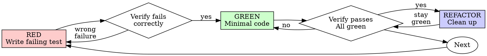

# Разработка через тесты (TDD)

## Обзор

Сначала напиши тест. Убедись, что он падает. Затем напиши минимальный код, чтобы он прошёл.

**Основной принцип:** если ты не видел, как тест падает, ты не знаешь, проверяет ли он нужное.

**Нарушать букву правил — значит нарушать их дух.**

## Когда применять

**Всегда:**
- Новые фичи
- Исправления багов
- Рефакторинг
- Изменения поведения

**Исключения (согласуй со своим партнёром по работе):**
- Одноразовые прототипы
- Сгенерированный код
- Конфигурационные файлы

Думаешь «в этот раз можно без TDD»? Стоп. Это рационализация.

## Железный закон

```
NO PRODUCTION CODE WITHOUT A FAILING TEST FIRST
```

Написал код до теста? Удали его. Начни заново.

**Без исключений:**
- Не оставляй его как «справочный» вариант
- Не «адаптируй» его при написании тестов
- Не смотри на него
- Удалить — значит удалить

Реализуй заново, опираясь только на тесты. Точка.

## Red-Green-Refactor



### RED — напиши падающий тест

Напиши один минимальный тест, который показывает, что должно происходить.

<Good>
```typescript
test('retries failed operations 3 times', async () => {
  let attempts = 0;
  const operation = () => {
    attempts++;
    if (attempts < 3) throw new Error('fail');
    return 'success';
  };

  const result = await retryOperation(operation);

  expect(result).toBe('success');
  expect(attempts).toBe(3);
});
```
Понятное имя, проверяет реальное поведение, одна вещь
</Good>

<Bad>
```typescript
test('retry works', async () => {
  const mock = jest.fn()
    .mockRejectedValueOnce(new Error())
    .mockRejectedValueOnce(new Error())
    .mockResolvedValueOnce('success');
  await retryOperation(mock);
  expect(mock).toHaveBeenCalledTimes(3);
});
```
Расплывчатое имя, тестирует мок, а не код
</Bad>

**Требования:**
- Одно поведение
- Понятное имя
- Реальный код (моки — только если без них никак)

### Проверь RED — смотри, как он падает

**ОБЯЗАТЕЛЬНО. Никогда не пропускать.**

```bash
npm test path/to/test.test.ts
```

Убедись:
- Тест падает (а не ломается с ошибкой)
- Сообщение об ошибке ожидаемое
- Падает потому, что фичи нет (а не из-за опечаток)

**Тест проходит?** Ты тестируешь уже существующее поведение. Исправь тест.

**Тест ломается с ошибкой?** Исправь ошибку и запускай снова, пока тест не начнёт падать правильно.

### GREEN — минимальный код

Напиши самый простой код, который проходит тест.

<Good>
```typescript
async function retryOperation<T>(fn: () => Promise<T>): Promise<T> {
  for (let i = 0; i < 3; i++) {
    try {
      return await fn();
    } catch (e) {
      if (i === 2) throw e;
    }
  }
  throw new Error('unreachable');
}
```
Ровно столько, чтобы пройти тест
</Good>

<Bad>
```typescript
async function retryOperation<T>(
  fn: () => Promise<T>,
  options?: {
    maxRetries?: number;
    backoff?: 'linear' | 'exponential';
    onRetry?: (attempt: number) => void;
  }
): Promise<T> {
  // YAGNI
}
```
Переусложнено
</Bad>

Не добавляй фичи, не рефактори другой код и не «улучшай» сверх того, что проверяет тест.

### Проверь GREEN — смотри, как он проходит

**ОБЯЗАТЕЛЬНО.**

```bash
npm test path/to/test.test.ts
```

Убедись:
- Тест проходит
- Остальные тесты по-прежнему проходят
- Вывод чистый (без ошибок и предупреждений)

**Тест падает?** Исправь код, а не тест.

**Другие тесты падают?** Исправь их сейчас.

**«Остальные тесты» — это весь набор тестов проекта, а не только твой файл.** Зелёный прогон теста, который ты написал, — ещё не зелёный набор. Прежде чем считать изменение готовым, запусти команду тестов проекта (голый `pytest`, `npm test`, `cargo test` — что использует репозиторий), даже если задача касалась только одного тестового файла. Область задачи ограничивает результат, но не проверку. Любой провал, который покажет этот прогон, — в том числе тот, который ты не вызывал, — указывается в отчёте по имени. Красный тест, который промелькнул у тебя на глазах и о котором ты не написал, делает отчёт недостоверным из-за умолчания.

### REFACTOR — наведи порядок

Только после зелёного прогона:
- Убери дублирование
- Улучши имена
- Вынеси вспомогательные функции

Держи тесты зелёными. Не добавляй новое поведение.

### Повтор

Следующий падающий тест для следующей фичи.

## Хорошие тесты

| Качество | Хорошо | Плохо |
|----------|--------|-------|
| **Минимальность** | Одна вещь. Есть «и» в имени? Раздели тест. | `test('validates email and domain and whitespace')` |
| **Ясность** | Имя описывает поведение | `test('test1')` |
| **Показывает намерение** | Демонстрирует желаемый API | Скрывает, что код должен делать |

Когда пишешь или меняешь любой тест, прочитай [writing-good-tests.md](writing-good-tests.md) — там правила, которые делают тесты честными:
- Назови изменение в продакшен-коде, из-за которого тест упадёт, — до того как его писать
- Проверяй реальное поведение, а не поведение мока
- Держи код, нужный только для тестов, в тестовых утилитах, вне продакшен-классов
- Разберись в побочных эффектах зависимости, прежде чем её мокать

## Типичные оправдания

| Отговорка | Реальность |
|-----------|------------|
| «Слишком просто, чтобы тестировать» | Простой код тоже ломается. Тест занимает 30 секунд. |
| «Напишу тесты потом» | Тесты, написанные после кода, сразу проходят — и это ничего не доказывает. Они могут проверять не то, тестировать реализацию вместо поведения или пропускать забытый крайний случай. Ты не видел, как они падают, значит не знаешь, ловят ли они баг. Тест-первый подход заставляет увидеть это падение. |
| «Тесты после дают ту же цель (важен дух, а не ритуал)» | Тесты после отвечают на вопрос «что делает этот код?», а тесты до — на вопрос «что он должен делать?». Тесты после предвзяты кодом, который уже написан: ты проверяешь те случаи, что вспомнил, а не те, которые открыл бы, думая о поведении заранее. Покрытие без доказательства, что тесты работают. |
| «Уже проверил вручную» | Ручная проверка хаотична: нет записи о том, что проверено, нельзя повторить её при изменении кода, легко забыть случаи под давлением. «Работало, когда я попробовал» ≠ полная проверка. Автоматические тесты запускаются одинаково каждый раз. |
| «Выбрасывать X часов — расточительство» | Ошибка невозвратных затрат: это время потрачено в любом случае. Реальный выбор: переписать с TDD (высокая уверенность) или оставить и добавить тесты задним числом (низкая уверенность, вероятны баги). Расточительно как раз хранить код, которому нельзя доверять. |
| «Оставлю как справочник, тесты напишу сначала» | Ты будешь его адаптировать. Это уже тесты после. Удалить — значит удалить. |
| «Сначала нужно разобраться» | Нормально. Выброси разведочный код и начни с TDD. |
| «Тяжело тестировать = непонятный дизайн» | Прислушайся к тесту. Тяжело тестировать — значит тяжело использовать. |
| «TDD замедлит меня» | TDD и есть прагматичный путь: он ловит баги до коммита, предотвращает регрессии и позволяет рефакторить без страха. «Прагматичные» срезания углов означают отладку в продакшене — это медленнее, а не быстрее. |
| «Ручная проверка быстрее» | Ручная проверка не доказывает крайние случаи. Придётся перепроверять каждое изменение. |
| «В существующем коде нет тестов» | Ты его улучшаешь. Добавь тесты для существующего кода. |

## Красные флаги — СТОП и начать заново

- Код раньше теста
- Тест после реализации
- Тест проходит сразу
- Не можешь объяснить, почему тест упал
- Тесты добавлены «потом»
- Оправдание «только в этот раз»
- «Я уже проверил вручную»
- «Тесты после дают то же самое»
- «Важен дух, а не ритуал»
- «Оставлю как справочник» или «адаптирую существующий код»
- «Уже потратил X часов, удалять расточительно»
- «TDD — догма, я действую прагматично»
- «Тут другой случай, потому что…»

**Всё это означает: удали код. Начни заново с TDD.**

## Пример: исправление бага

**Баг:** принимается пустой email

**RED**
```typescript
test('rejects empty email', async () => {
  const result = await submitForm({ email: '' });
  expect(result.error).toBe('Email required');
});
```

**Проверь RED**
```bash
$ npm test
FAIL: expected 'Email required', got undefined
```

**GREEN**
```typescript
function submitForm(data: FormData) {
  if (!data.email?.trim()) {
    return { error: 'Email required' };
  }
  // ...
}
```

**Проверь GREEN**
```bash
$ npm test
PASS
```

**REFACTOR**
При необходимости вынеси валидацию нескольких полей в отдельную функцию.

## Чек-лист проверки

Прежде чем считать работу завершённой:

- [ ] У каждой новой функции или метода есть тест
- [ ] Каждый тест был увиден падающим до реализации
- [ ] Каждый тест упал по ожидаемой причине (фичи нет, а не опечатка)
- [ ] Написан минимальный код, чтобы пройти каждый тест
- [ ] Все тесты проходят
- [ ] Вывод чистый (без ошибок и предупреждений)
- [ ] Тесты используют реальный код (моки — только если без них никак)
- [ ] Покрыты крайние случаи и ошибки

Не можешь отметить все пункты? Значит, ты пропустил TDD. Начни заново.

## Когда застрял

| Проблема | Решение |
|----------|---------|
| Не знаешь, как тестировать | Напиши желаемый API. Сначала напиши утверждение (assertion). Спроси своего партнёра по работе. |
| Тест слишком сложный | Дизайн слишком сложный. Упрости интерфейс. |
| Приходится мокать всё | Код слишком связан. Используй внедрение зависимостей. |
| Настройка теста огромная | Вынеси вспомогательные функции. Всё ещё сложно? Упрости дизайн. |

## Интеграция с отладкой

Нашёл баг? Напиши падающий тест, который его воспроизводит. Пройди цикл TDD. Тест докажет исправление и защитит от регрессии.

Никогда не исправляй баги без теста.

## Главное правило

```
Production code → test exists and failed first
Otherwise → not TDD
```

Код продакшена → тест существует и сначала упал.
Иначе → это не TDD.

Без исключений, пока партнёр по работе не разрешит их явно.
